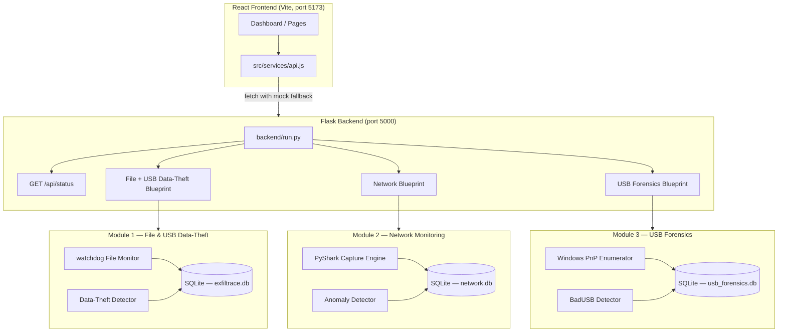

# ExfilTrace Security Monitor

An integrated, real-time security monitoring platform that detects insider threats involving USB devices, sensitive file activity, and suspicious network exfiltration — combined in one live dashboard.

Built as an Information Security lab project under the guidance of Dr. Raghavendra Ganiga.

---

## Overview

ExfilTrace combines three independent monitoring modules into a single Flask backend served to a React frontend:

| Module | Purpose |
|--------|---------|
| **File Monitoring & USB Data-Theft Detection** | Monitors file-system activity on watched directories. Detects copies of sensitive files to removable USB drives, bulk transfers, and archive creation. |
| **Network Monitoring & Anomaly Detection** | Captures and aggregates network flows. Flags volumetric exfiltration spikes, first-seen external destinations, and connections on suspicious ports. |
| **USB Forensics & BadUSB Detection** | Enumerates connected USB devices via Windows PnP. Fingerprints hardware descriptors, detects impersonation and keystroke-injection hardware (BadUSB), and generates forensic alerts. |

The dashboard shows live data from all three modules simultaneously. Pages fall back to illustrative mock data automatically when the backend is not running, so the UI can always be demonstrated.

---

## Quick Start

### Prerequisites

| Requirement | Minimum version |
|-------------|----------------|
| Python | 3.10 or later |
| Node.js | 18 LTS or later |
| npm | bundled with Node.js |
| Windows | Required for live USB hardware enumeration (modules 1 & 3) |
| Wireshark / TShark | Optional — required only for live network packet capture |

> **Note for macOS users:** AirPlay Receiver occupies port 5000 by default.
> Disable it in *System Settings → General → AirDrop & Handoff → AirPlay Receiver*,
> or change `api.port` in `backend/config.json`.

### One-command launch

Clone the repository and run the launcher:

```powershell
git clone <repository-url>
cd exfiltrace-security-monitor
.\start.bat
```

On Linux or macOS:

```bash
git clone <repository-url>
cd exfiltrace-security-monitor
chmod +x start.sh
./start.sh
```

The launcher will:

1. Check for Python and Node.js prerequisites.
2. Create a Python virtual environment in `.venv/` (first run only).
3. Install Python backend dependencies from `backend/requirements.txt`.
4. Install Node.js frontend dependencies using `npm ci`.
5. Start the Flask backend on **http://127.0.0.1:5000**.
6. Start the Vite dev server on **http://localhost:5173**.
7. Open the dashboard automatically in your default browser.

**To stop:** press any key in the launcher window (Windows), or Ctrl+C (Linux/macOS). Both processes are stopped cleanly.

**Application URLs**

| Service | URL |
|---------|-----|
| Dashboard | http://localhost:5173 |
| Backend API | http://127.0.0.1:5000/api |
| API health check | http://127.0.0.1:5000/api/health |
| Unified system status | http://127.0.0.1:5000/api/status |

---

## Manual Setup

If you prefer to control the services individually:

### Backend

```bash
# Create and activate virtual environment
python -m venv .venv
.venv\Scripts\activate      # Windows
# source .venv/bin/activate  # Linux / macOS

# Install dependencies
pip install -r backend/requirements.txt

# Run from the repository root
python backend/run.py
```

### Frontend

```bash
npm install          # or: npm ci
npm run dev          # development server on http://localhost:5173
npm run build        # production build to dist/
```

### Backend configuration

Edit `backend/config.json` to customise:

- `monitored_directories` — list of absolute paths for the file monitor to watch.
- `sensitive_rules` — file extensions, name keywords, and directory names considered sensitive.
- `api.host` / `api.port` — bind address and port (default `127.0.0.1:5000`).

See [`backend/config.json`](backend/config.json) for the full schema with defaults.

---

## Architecture



---

## Features

### Module 1 — File Monitoring & USB Data-Theft Detection
*Developed by Rohith*

- Real-time filesystem monitoring using Python `watchdog`.
- Sensitive-file classification by extension, filename keyword, and directory path.
- Automatic deduplication of rapid event bursts.
- Data-theft correlation: flags file copies to removable USB volumes, bulk transfers (≥10 files in 2 minutes), and archive creation during a USB session.
- REST endpoints: `GET /api/files/events`, `/api/files/sensitive`, `/api/files/stats`.
- Persistent SQLite storage for all file events and alerts.

### Module 2 — Network Monitoring & Anomaly Detection
*Developed by NP*

- Live packet capture via PyShark/TShark (requires Wireshark), with a built-in **simulation mode** that works without elevated privileges or hardware.
- Flow aggregation and per-interval traffic statistics.
- Four detection rules:
  - **Volumetric spike** — rolling baseline with 3σ threshold.
  - **First-seen external destination** — new public IP receiving ≥ 1 MB outbound.
  - **Suspicious ports** — FTP (21), Telnet (23), SMB (445), RDP (3389), Metasploit (4444), IRC (6667), Tor (9001), Elite RAT (31337).
  - **Private range exclusion** — RFC 1918, loopback, and link-local addresses are never treated as external.
- REST endpoints: `GET /api/network/events`, `/api/network/stats`, `/api/network/traffic`.
- Correlation helper functions for future cross-module joining.

### Module 3 — USB Forensics & BadUSB Detection
*Developed by Vighn*

- Windows PnP device enumeration via PowerShell `Get-CimInstance Win32_PnPEntity`.
- Per-device descriptor fingerprinting (VID, PID, serial, manufacturer, USB version, interface list, SHA-256 descriptor hash).
- Seven explainable detection rules with per-rule risk scores:
  - Keyboard interface on mass-storage device (BadUSB / Rubber Ducky signature).
  - Hardware VID:PID matches known attack tools (Hak5 Rubber Ducky, Teensy, MalDuino, RPi Pico HID, Digispark).
  - Short-lived HID connection (scripted payload injection pattern).
  - Vendor impersonation (manufacturer string contradicts registered VID).
  - Bogus serial number on storage devices.
  - Unregistered vendor (not in IEEE USB-IF registry).
  - First-ever connection to this host.
- Trust management: mark devices as TRUSTED, UNKNOWN, or SUSPICIOUS via the API.
- Persistent forensic database with full event and alert history.
- Five built-in simulation scenarios for demonstration without real attack hardware.
- REST endpoints: `GET /api/usb/devices`, `GET /api/usb/alerts`, `POST /api/usb/devices/{id}/trust`, `POST /api/usb/scan`, `POST /api/usb/simulate`, `GET /api/usb/status`.

---

## Technology Stack

| Layer | Technology |
|-------|-----------|
| Frontend framework | React 19 + Vite 8 |
| Frontend styling | Tailwind CSS v4 |
| Charts | Recharts |
| Routing | React Router DOM v7 |
| Icons | Lucide React |
| Backend framework | Python 3.12, Flask 3 |
| CORS | Flask-Cors |
| File monitoring | Python `watchdog` |
| Network capture | PyShark (optional; simulation mode available) |
| USB enumeration | Windows PnP via PowerShell `Get-CimInstance` |
| Database | SQLite (one database per module) |
| Testing | pytest |

---

## API Reference

All endpoints are served under `http://127.0.0.1:5000/api`.

### System

| Method | Endpoint | Description |
|--------|---------|-------------|
| `GET` | `/api/status` | Unified system status — uptime, all module health |
| `GET` | `/api/health` | Simple health check — `{"status": "ok"}` |

### File Monitoring (Module 1)

| Method | Endpoint | Description |
|--------|---------|-------------|
| `GET` | `/api/files/events` | File events. Query params: `limit`, `offset`, `type`, `sensitive`, `removable`, `search`, `since`, `until` |
| `GET` | `/api/files/sensitive` | Sensitive file inventory |
| `GET` | `/api/files/stats` | Aggregate file statistics |
| `POST` | `/api/monitoring/<start\|stop>` | Start or stop the file monitor |
| `GET` | `/api/config` | Current monitor configuration |
| `POST` | `/api/config/directories` | Add or remove a watched directory |

### Network Monitoring (Module 2)

| Method | Endpoint | Description |
|--------|---------|-------------|
| `GET` | `/api/network/events` | Network flow events. Query params: `start`, `end` (ISO 8601 UTC) |
| `GET` | `/api/network/stats` | Aggregate counters — packets, bytes, connections |
| `GET` | `/api/network/traffic` | 30-minute traffic buckets for the chart |

### USB Forensics (Module 3)

| Method | Endpoint | Description |
|--------|---------|-------------|
| `GET` | `/api/usb/devices` | All USB devices. Query param: `connected=true` |
| `GET` | `/api/usb/devices/{id}` | Single device with full fingerprint |
| `POST` | `/api/usb/devices/{id}/trust` | Set trust — body: `{"status": "TRUSTED\|UNKNOWN\|SUSPICIOUS"}` |
| `GET` | `/api/usb/alerts` | BadUSB alerts. Query params: `limit`, `unack=true` |
| `POST` | `/api/usb/alerts/{id}/ack` | Acknowledge an alert |
| `POST` | `/api/usb/scan` | Trigger an immediate hardware scan |
| `POST` | `/api/usb/simulate` | Inject a test device. Body: `{"scenario": "<name>"}` |
| `GET` | `/api/usb/status` | USB module health and device counters |

**Simulation scenarios** (for `POST /api/usb/simulate`):

| `scenario` | Description |
|-----------|-------------|
| `badusb_sandisk` | Cloned SanDisk drive exposing a HID keyboard endpoint |
| `teensy_injector` | Teensy 2.0 known exploit hardware signature |
| `legit_logitech` | Genuine Logitech USB receiver (SAFE) |
| `legit_sandisk` | Genuine SanDisk Ultra Fit (SAFE) |
| `unregistered_kingston` | Kingston drive with unregistered serial |

---

## Configuration

### `backend/config.json`

```json
{
  "monitored_directories": [],
  "database_path": "data/exfiltrace.db",
  "sensitive_rules": {
    "extensions": [".kdbx", ".pem", ".key", ".pfx", ".p12", ".sql", ".bak", ".env"],
    "filename_keywords": ["confidential", "password", "credential", "secret", "salary"],
    "directories": ["confidential", "hr", "finance", "secrets"]
  },
  "api": {
    "host": "127.0.0.1",
    "port": 5000
  }
}
```

### Environment variables

| Variable | Module | Default | Purpose |
|----------|--------|---------|---------|
| `VITE_API_URL` | Frontend | `http://localhost:5000/api` | Backend base URL |
| `EXFILTRACE_NETWORK_DB` | Network | `backend/network/exfiltrace_network.db` | Network SQLite path |
| `EXFILTRACE_USB_POLL_INTERVAL` | USB | `3.0` | USB scan interval (seconds) |
| `EXFILTRACE_IFACE` | Network | system default | Network interface for live capture |
| `EXFILTRACE_API_PORT` | Network | `5000` | Override API port |

---

## Testing

Run the complete backend test suite from the repository root:

```bash
python -m pytest backend/ -v
```

**Verified results (Python 3.12.6, pytest 9.1.1):**

```
backend/network/tests/test_api.py           7 passed
backend/network/tests/test_capture.py       4 passed
backend/network/tests/test_detector.py     15 passed
backend/tests/test_api.py                  10 passed
backend/tests/test_detection.py            13 passed
backend/tests/test_file_monitor.py         12 passed
backend/tests/test_service_e2e.py           3 passed
backend/tests/test_usb.py                  11 passed
backend/usb/tests/test_api.py               6 passed
backend/usb/tests/test_db.py                4 passed
backend/usb/tests/test_detector.py          7 passed
backend/usb/tests/test_windows_pnp.py       3 passed

93 passed in 7.75s
```

Verify the frontend builds without errors:

```bash
npm run build
```

---

## Repository Structure

```
exfiltrace-security-monitor/
│
├── backend/
│   ├── app/                      # Module 1: File + USB Data-Theft Detection
│   │   ├── api.py                # Flask blueprint (/api/files/*, /api/alerts)
│   │   ├── config.py             # Config loader
│   │   ├── db.py                 # SQLite schema + queries
│   │   ├── detection.py          # Data-theft correlation engine
│   │   ├── file_monitor.py       # watchdog monitor
│   │   ├── service.py            # MonitoringService orchestrator
│   │   └── usb/                  # USB backend (Windows/simulated)
│   │
│   ├── network/                  # Module 2: Network Monitoring
│   │   ├── api.py                # Flask blueprint (/api/network/*)
│   │   ├── capture.py            # PyShark + simulation engine
│   │   ├── detector.py           # 4 anomaly rules
│   │   ├── db.py                 # SQLite schema
│   │   ├── serializers.py        # DB rows → frontend JSON
│   │   ├── correlation.py        # Window query helpers
│   │   └── tests/
│   │
│   ├── usb/                      # Module 3: USB Forensics + BadUSB
│   │   ├── api.py                # Flask blueprint (/api/usb/*)
│   │   ├── service.py            # UsbForensicsService
│   │   ├── detector.py           # 7-rule BadUSB engine
│   │   ├── db.py                 # SQLite schema + CRUD
│   │   ├── models.py             # UsbDevice, BadUsbAlert, etc.
│   │   ├── simulator.py          # 5 demonstration scenarios
│   │   ├── windows_pnp.py        # PowerShell hardware enumeration
│   │   ├── config.py             # Known vendors, exploit signatures
│   │   └── tests/
│   │
│   ├── tests/                    # Integration + E2E tests for modules 1 & 2
│   ├── run.py                    # Unified application entry point
│   ├── config.json               # Runtime configuration
│   ├── requirements.txt          # Python dependencies
│   └── pytest.ini
│
├── src/                          # React frontend
│   ├── pages/                    # Dashboard, FileMonitoring, NetworkAnalysis,
│   │   │                         # USBForensics, Incidents, Reports
│   ├── components/               # Reusable UI components
│   ├── layout/                   # Sidebar, Navbar, Layout
│   ├── services/api.js           # Fetch wrappers with mock fallback
│   ├── data/mockData.js          # API contract shapes + demo data
│   └── hooks.js                  # useApi(fetcher) hook
│
├── public/                       # Static assets
├── start.bat                     # Windows one-command launcher
├── start.sh                      # Linux / macOS one-command launcher
├── index.html                    # Vite HTML template
├── vite.config.js
├── package.json
├── package-lock.json
├── PROJECT_CONTEXT.md            # Team reference document
└── AGENTS.md                     # Agent workflow conventions
```

---

## Limitations

- **USB hardware enumeration is Windows-only.** The USB Forensics module queries `Win32_PnPEntity` via PowerShell. On other platforms the module starts in simulation mode and serves the pre-loaded scenario devices only.
- **Live network capture requires TShark/Wireshark and elevated privileges.** Without them the network module operates in simulation mode, serving realistic synthetic traffic.
- **File monitoring is inactive until directories are configured.** Add paths to `monitored_directories` in `backend/config.json`, or POST to `/api/config/directories` at runtime.
- **The Correlation Engine is not yet implemented.** Incident and Report pages show illustrative mock data. Cross-module correlation (joining USB sessions with file events and network flows) is planned as future work.
- **Some dashboard pages serve mock data.** The Incidents and Reports pages use the mock data defined in `src/data/mockData.js`. USB Forensics, Network Analysis, and File Monitoring pages serve live backend data when the backend is running.
- **Times shown in the browser are local time.** The backend stores and returns UTC timestamps; browsers convert them to local time automatically.

---

## Future Work

- **Correlation Engine** — join USB session windows with file events and network flows to produce unified incident records and XML reports.
- **Incident & Alert API** — replace mock Incidents and Reports pages with live endpoints.
- **Write-blocking** — software USB write-blocking to preserve forensic evidence on insertion.
- **Cross-platform USB enumeration** — `lsusb` / `udevadm` support for Linux.
- **Live packet capture hardening** — graceful interface selection and better error reporting.
- **Improved baseline data** — pre-populate the network database with realistic multi-hour baseline history.

---

## Contributors

- **Rohith** — File Monitoring & USB Data-Theft Detection module (`backend/app/`)
- **NP** — Network Monitoring & Anomaly Detection module (`backend/network/`)
- **Vighn** — USB Forensics & BadUSB Detection module (`backend/usb/`), frontend integration, unified launcher

Faculty advisor: Dr. Raghavendra Ganiga

---

## License

This project does not currently include an open-source license. All rights reserved by the contributors.
