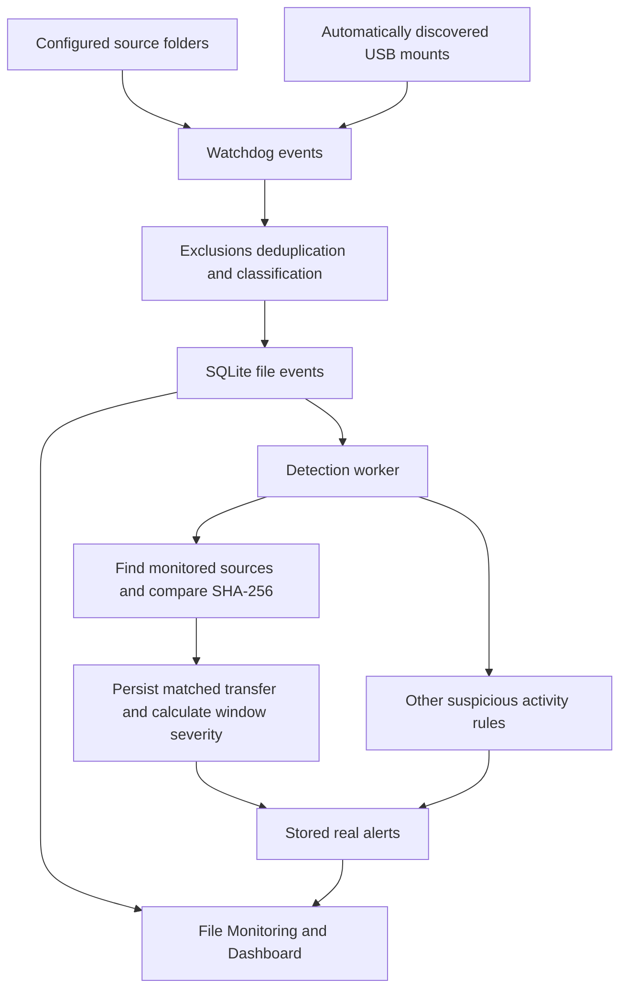

# File Monitoring and USB Data Theft Detection

ExfilTrace records activity in configured folders and automatically watched USB volumes. When bytes written to a USB match a file in a currently monitored source folder, it records an explainable transfer alert regardless of filename or sensitivity. Folder management updates active watches and persistent configuration at runtime. Transfer severity depends on the number and total size of matched copies, not whether the name contains confidential.

## Implementation and data flow

| Source | Responsibility |
|---|---|
| [file_monitor.py](../backend/app/file_monitor.py) | Watchdog observers, classification, exclusions, event deduplication and recording |
| [detection.py](../backend/app/detection.py) | Source search, hashing, transfer verification and additional suspicious-activity rules |
| [service.py](../backend/app/service.py) | Monitor lifecycle, asynchronous detection worker and safe folder changes |
| [config.py](../backend/app/config.py) | Defaults, active configuration path and atomic persistence |
| [db.py](../backend/app/db.py) | SQLite events, transfer evidence and alert queries |
| [api.py](../backend/app/api.py) | File, alert, status and directory-management routes |
| [MonitoredFolders.jsx](../src/components/MonitoredFolders.jsx) | Folder list, active/errors, add/edit/remove and automatic USB watch display |
| [FileMonitoring.jsx](../src/pages/FileMonitoring.jsx) | Activity filters, statistics, sensitive-path history and alerts |



## User folders and automatic USB watches

`MonitoringService` starts the file observer before USB monitoring. This allows the USB startup poll to immediately attach removable-volume watches for devices already connected. Insertion adds roots; removal and mount changes remove or replace roots as needed. Events are associated with the device through `UsbMonitor.volume_for(path)`, which checks actual discovered mount containment rather than string similarity alone.

User-managed folders are persisted in `monitored_directories`. Automatically watched USB roots are not saved into that list by insertion callbacks. The File Monitoring page displays them separately without edit/remove controls. Requests to add a current USB path as a user-managed source or remove an automatic watch through folder management are rejected.

## Safe folder management

The Monitored Folders section lists configured paths, active status and per-folder errors. It retains the last successful response if refresh fails, and disables mutation controls while that response is known to be stale.

Path validation happens on the backend. Add/edit require an absolute existing directory; Windows paths must include a drive or UNC share rather than a root-relative path. Normalization uses real paths and operating-system case normalization to identify aliases and duplicates. Files, missing paths, blank input and relative paths are rejected. Remove accepts a configured path even if its directory has since disappeared, enabling cleanup of stale configuration.

For a running monitor, adding schedules the watch first, saves configuration, and rolls back the new watch if persistence fails. Editing follows this order:

1. Confirm the original is still configured and the replacement is valid and not a duplicate.
2. Successfully schedule the replacement watch while the old watch remains active.
3. Atomically persist the replacement list.
4. Stop the old watch. A watch-removal failure attempts to restore the original configuration and remove the replacement.

Watch or save failure leaves the old folder configured rather than silently abandoning it. Removal persists the revised list and stops monitoring; a stop failure restores configuration. It never deletes the directory or its contents. Folder mutations and service lifecycle operations share a lock, while observer operations avoid holding the file monitor's event-state lock to prevent watchdog dispatch deadlocks.

Configuration persistence writes a temporary file in the active configuration directory and atomically replaces the target. In-memory configuration changes only after the save succeeds. Other JSON settings are preserved. The default path is `backend/config.json`; `--config` or `EXFILTRACE_CONFIG` can select another file. Restart must use the same configuration path to restore the saved list.

A stopped monitor can persist additions for its next start. Editing is rejected while stopped because the replacement cannot first be proven watchable. All successful running-folder changes take effect without restarting the service.

## Filesystem events and classification

Recursive watchdog handlers record `CREATED`, `MODIFIED`, `DELETED` and `RENAMED` for files. Directory events are ignored. A rename stores both original and destination paths. A filesystem create event is not itself evidence of copying or theft.

Recorded fields include time, event type, paths, filename, extension, size when obtainable, sensitivity and reason, removable-volume association, USB device identity, event risk and watch-root context. Process name, user attribution and verified access/read auditing are unavailable.

Sensitivity is descriptive metadata based on configured extensions, name keywords and ancestor directory names. For example, `.pem`, a password keyword or an `hr` directory can mark an event sensitive. This still drives sensitive-path statistics and some additional rules, but no longer gates verified USB copy alerts.

Exclusion patterns and directories suppress temporary/download files, repository caches and other configured noise. Writes to the active SQLite database path are suppressed to avoid monitoring the monitor's own storage activity.

Duplicate event keys include type, path and rename destination. The default suppression window is 1.5 seconds. A MODIFY immediately after CREATE refreshes the created record's size instead of creating a second record. File size can therefore be updated as an in-progress copy grows.

Event risk and alert severity are distinct. Raw event risk can be HIGH for a sensitive file on removable media, while the independently calculated transfer alert can still be MEDIUM because only one small file was copied.

## How a USB transfer is verified

The detector processes removable CREATED, RENAMED and MODIFIED events. It waits for the destination size to repeat across checks, using a default 0.5-second interval and up to twenty checks. If it cannot read the destination, it cannot verify its contents.

It searches currently configured source folders and recent source events for eligible candidates. Same-name files are prioritized, but other same-size files are considered so a renamed destination can match. Candidate real paths must remain within a current source root. A USB file cannot serve as its own monitored source. Excluded paths are skipped.

For each candidate, the detector compares source and destination SHA-256. Source hashes are cached by normalized path, size, modification time and change time, allowing reuse while invalidating a changed source. Source disappearance during search is contained. Matching bytes produce `MONITORED_FILE_COPIED_TO_USB` with verdict `VERIFIED_TRANSFER`, source/destination evidence and related file/USB event IDs.

This establishes that matching content exists at both locations when inspected. It does not identify the person or process, prove authorization status, distinguish identical pre-existing content from a specific causal copy operation, or prove the data subsequently left the USB.

If a same-named monitored source exists but content differs or cannot be hashed, `MONITORED_NAME_MATCH_ON_USB` records a suspicious possible copy instead. No content match means no verified transfer. The existing hash-size limit is 268,435,456 bytes, or 256 MiB, and source traversal is bounded at 50,000 entries. These limits, missing originals and unreadable files can prevent verification; raw filesystem events are still recorded.

## Persistent transfer window and severity

Matched transfers are stored in the additive `usb_transfers` table with the file-event reference, USB identity, insertion-event reference, source/destination, normalized destination key, digest, byte size and UTC processing timestamp. The USB insertion lookup is bounded by the original file-event timestamp so queued work is not incorrectly assigned to a later reconnection.

The window is scoped to one physical device and connection. Evidence survives a service restart with the same database; an actual new insertion starts a different connection context. The rolling window is measured when matching evidence is persisted, so a delayed detection queue can shift grouping relative to the original filesystem event times.

| Setting | Default | Meaning |
|---|---:|---|
| `detection.usb_transfer_file_limit` | 3 | Maximum distinct destination files before critical priority |
| `detection.usb_transfer_size_limit_bytes` | 5,000,000 | Maximum total matched bytes before critical priority |
| `detection.usb_transfer_window_seconds` | 120 | Rolling comparison window for the current connection |

Within that window, **CRITICAL** means `fileCount > 3 OR totalBytes > 5,000,000`; otherwise the verified-copy alert is **MEDIUM**. The byte threshold is decimal 5 MB, not 5 MiB.

| Example in a fresh window | New alert severity |
|---|---|
| One small ordinary file | MEDIUM |
| Two small files | MEDIUM |
| Three files totaling exactly 5,000,000 bytes | MEDIUM |
| A fourth distinct file | CRITICAL |
| One file of 5,000,001 bytes | CRITICAL |
| Two matched files whose total exceeds 5 MB | CRITICAL on the threshold-crossing copy |

Repeated notifications for the same destination/content within the window do not inflate the count or duplicate its alert. Different matched content versions at one destination accumulate bytes but count as one destination file. Each alert states the current totals and thresholds. Earlier medium alerts are not retroactively rewritten after a later copy crosses a threshold, and historical alerts from older policies retain their original rules/severities.

The new settings govern current USB copy priority; the older `bulk_file_threshold` is not the controlling limit for this policy. Content verification limits such as `max_hash_bytes` remain separate from critical-size thresholds.

## Other suspicious activity rules

| Rule | Meaning and current priority |
|---|---|
| `MONITORED_NAME_MATCH_ON_USB` | Same name but unverifiable/different bytes; MEDIUM, or CRITICAL when the individual file exceeds the size threshold |
| `SENSITIVE_FILE_ON_USB` | Sensitive-looking USB file without a known source; MEDIUM and unverified |
| `BULK_COPY_TO_USB` | Distinct USB writes crossing count/size limits without this event being a verified copy; CRITICAL but SUSPICIOUS |
| `ARCHIVE_ON_USB` | Unverified archive creation; MEDIUM, with no inspection of archive contents |
| `SENSITIVE_FILE_MOVED_TO_USB` | Deletion following a same-named USB creation; HIGH, but the deleted original cannot be compared |
| `SENSITIVE_ACTIVITY_DURING_USB` | Sensitive source activity overlapping a mounted USB connection; LOW, or MEDIUM for deletion, explicitly not transfer proof |

Verified copies are not additionally labeled as generic archive/bulk suspicions for that same processing path. The additional rules remain review signals; none proves unauthorized theft.

## Database and endpoints

| Table | Purpose |
|---|---|
| `file_events` | Raw filesystem observations and associations |
| `usb_events` | Connection/mount evidence used to identify the relevant insertion |
| `usb_transfers` | Matched-copy records and persisted window accounting |
| `alerts` | Real findings, severity/verdict, explanations, evidence and deduplication keys |

New records use UTC ISO 8601 ending in `Z`. Time-aware SQLite comparisons preserve compatibility with older offset-formatted rows. The database opens short-lived connections, uses parameterized values and attempts WAL mode for concurrent readers/writers.

| Endpoint | Purpose |
|---|---|
| `GET /api/files/events` | Event history; type, sensitivity, removable, search, since/until and pagination filters |
| `GET /api/files/stats` | Recorded event and distinct sensitive-path counts |
| `GET /api/files/sensitive` | Latest stored event per sensitive source path, up to the requested limit |
| `GET /api/alerts` | Findings; severity/verdict filters and pagination |
| `GET /api/config/directories` | Configured folder status, automatic USB watches and transfer policy |
| `POST /api/config/directories` | Add, edit or remove user-managed folders |
| `GET /api/status` | File/USB monitor state, watches and diagnostics |

Example folder operations reuse the same route:

```json
{"action":"add","path":"C:\\Work\\Documents"}
```

```json
{"action":"edit","previousPath":"C:\\Work\\Documents","path":"C:\\Work\\Archive"}
```

```json
{"action":"remove","path":"C:\\Work\\Archive"}
```

Invalid paths return 400, duplicates/conflicts return 409, and watch/persistence failures return 503 with an explanation. Existing `monitored_directories` response data remains available alongside the newer status fields.

## Runtime and website behavior

The normal service queues detection work on a background worker, keeping expensive source search and hashing off watchdog's event dispatch path. Tests can use synchronous detection for deterministic results. The frontend polls approximately three seconds after each completed request, uses a ten-second timeout, aborts on unmount and retains successful data on refresh errors.

Dashboard and File Monitoring both display real stored alerts. Their Recorded alerts count includes ordinary matched copies through the same `/api/alerts` route. The isolated BadUSB overlay is separate and does not alter this table or its totals. Activity tables show recent records rather than a complete disk inventory.

Start the integrated backend from the repository root with `& .\backend\.venv\Scripts\python.exe .\backend\run.py`. Start Vite with `npm.cmd run dev`, ensuring `VITE_API_URL` matches the backend `/api` base.

For a harmless test, create two local directories, add one through File Monitoring, create an ordinary file, and confirm active status/activity. Edit to the other directory, try an invalid replacement, and confirm the old configuration survives. Remove monitoring and verify the actual files remain. Re-add, restart with the same configuration and check the watch is active again. Copy ordinary files to a discovered USB mount and inspect hashes and threshold evidence on Dashboard. Wait beyond the window or reconnect before a fresh count test.

Tests in [test_directories.py](../backend/tests/test_directories.py), [test_file_monitor.py](../backend/tests/test_file_monitor.py), [test_detection.py](../backend/tests/test_detection.py) and [test_service_e2e.py](../backend/tests/test_service_e2e.py) cover live watches, rollback, persistence, content matching and threshold boundaries. Run `& .\backend\.venv\Scripts\python.exe -m pytest backend/tests -q`, `npm.cmd test`, `npm.cmd run lint` and `npm.cmd run build`.
