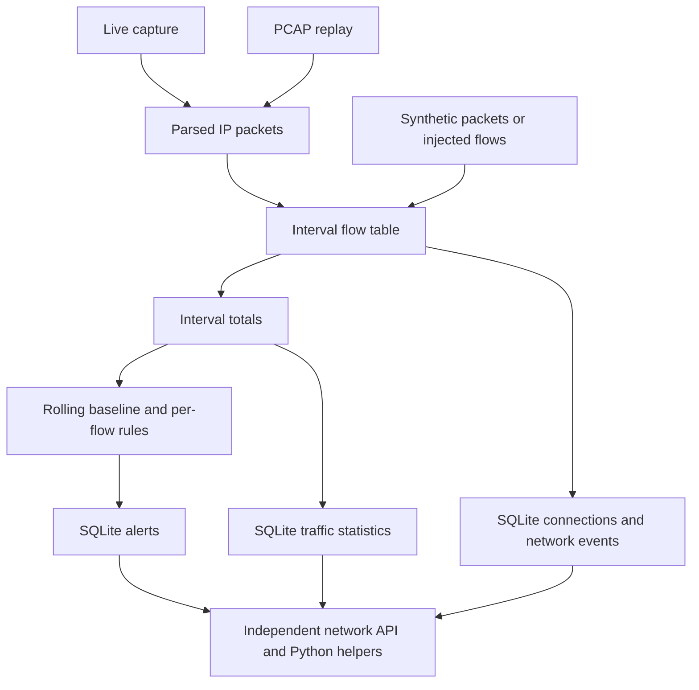

# Network Monitoring and Anomaly Detection

The network module collects or replays IP traffic, aggregates it into time intervals, detects unusual outbound activity and stores explainable findings in its own SQLite database. It supports live PyShark/TShark capture, PCAP replay and synthetic input. It is a separate backend: the integrated USB/file Flask service does not start it, and the current Network Analysis webpage still renders sample data rather than its endpoints.

## Module architecture

| Source | Responsibility |
|---|---|
| [capture.py](../backend/network/capture.py) | Capture modes, parsing, direction classification, flow aggregation and lifecycle |
| [detector.py](../backend/network/detector.py) | Baseline, first-seen tracker, alert generation and event risk |
| [config.py](../backend/network/config.py) | Environment variables, thresholds, ports and local address ranges |
| [db.py](../backend/network/db.py) | SQLite schema, insert/query helpers and summaries |
| [serializers.py](../backend/network/serializers.py) | CamelCase response fields and traffic chart buckets |
| [api.py](../backend/network/api.py) | Network events, statistics and traffic routes |
| [app.py](../backend/network/app.py) | Independent Flask application and health endpoint |
| [correlation.py](../backend/network/correlation.py) | Time-window reads and explicit USB-session tagging helpers |
| [simulate_exfil.py](../backend/network/simulate_exfil.py) | Scripted baseline/upload demonstration without actual network traffic |



The network API process can read a database populated by another capture process. Starting the API alone does not start packet capture. Capture status is process-local, so its health response does not report an engine running only in another Python process, even when both use the same SQLite file.

## Capture modes and lifecycle

`CaptureEngine` owns a flow table, rolling baseline, first-seen destination tracker, capture threads, packet queue, database connection and capture-session record. `start_capture`, `stop_capture` and `get_capture_status` provide process-local lifecycle helpers. Repeated start calls return the running engine's status rather than starting an additional engine.

| Mode | Input and dependencies |
|---|---|
| `simulate` | Synthetic traffic; no real packet transmission, TShark or capture privileges needed |
| `live` | `pyshark.LiveCapture`; requires PyShark, TShark on PATH and Windows Npcap/capture access |
| `pcap` | `pyshark.FileCapture` replays a supplied capture; PyShark and its TShark runtime are required |

Live prerequisites are checked before the thread starts. PCAP validation requires a file path; runtime parsing errors are reported later through capture status. Unknown modes are rejected. Start opens the database and records a capture session. Stop signals the threads, flushes remaining observations and timestamps the session's end.

Live capture uses a worker to parse incoming packets and feed a bounded queue of 100,000 entries. The aggregation loop drains it and periodically flushes. A full queue can drop packets with a warning, so statistics are observations rather than guaranteed complete link accounting.

The default aggregation interval is ten seconds. Synthetic generation has its own default one-second pacing; this does not make the default aggregation interval one second. PCAP flushes use packet-time boundaries as replay proceeds, with a final flush at completion.

## Packet parsing and flow aggregation

`ParsedPacket` contains time, source/destination IP, observed length, protocol, ports and an optional hostname hint. Parsing supports IPv4/IPv6 and TCP/UDP port extraction. Non-IP packets are skipped. An unreadable packet timestamp falls back to the current UTC time.

Protocol names are best-effort transport/port labels: 53 maps to DNS, 443 to HTTPS, 445 to SMB and 80 to HTTP; otherwise the transport is used. Port-based labeling does not prove the actual application protocol. DNS query names or TLS server-name fields can provide hostname hints, but the module does not decrypt traffic or establish complete DNS answer attribution.

Flow keys are `(source IP, destination IP, destination port, protocol)`. Source port is stored but is not part of the aggregation key, so separate source-port conversations can merge. Reverse-direction packets are generally separate keys rather than a fully reconstructed bidirectional connection.

Each flow accumulates byte counts, packet count, first/last observed times and a hostname hint. `packetSizeBytes` in an API network event is the aggregate flow bytes for that interval, not necessarily one physical packet's size. The observed length includes packet/frame accounting rather than a verified count of confidential application payload bytes.

## Direction and local address handling

The classifier uses explicit local ranges:

- IPv4 private ranges `10.0.0.0/8`, `172.16.0.0/12` and `192.168.0.0/16`.
- Loopback `127.0.0.0/8` and `::1/128`.
- Link-local `169.254.0.0/16` and `fe80::/10`.
- IPv6 unique-local `fc00::/7`.

Private-to-private traffic is INTERNAL, private-to-nonprivate is OUTBOUND, and nonprivate-to-private is INBOUND. Traffic with neither endpoint in these ranges defaults to OUTBOUND. This is an address-range heuristic, not an authoritative determination of which endpoint belongs to the host. `SIM_LOCAL_IP` supplies the synthetic host address rather than changing this live direction rule.

The module deliberately treats documentation address ranges such as `203.0.113.0/24` as external for its demonstration. Its `is_public` function means a valid address outside the listed local ranges, not comprehensive public Internet routability.

An implementation detail matters: INTERNAL packets are accumulated into `bytes_out` by the shared merge function. Local conversations are excluded from relevant per-flow destination/port checks, but their bytes can still influence the interval's volumetric baseline and totals. The current implementation therefore does not exclude all LAN bytes from every metric.

## Volumetric anomaly rule

`OutboundBaseline` stores a rolling sequence of interval byte totals. It uses population standard deviation and compares a new interval against the existing samples **before** adding that interval to the baseline.

The default requirements are at least ten baseline samples and at least 5,000,000 outbound bytes in the candidate interval. With a nonzero standard deviation:

```text
z = (candidate bytes - baseline mean) / baseline standard deviation
anomaly when z > 3
equivalently candidate > mean + 3 × standard deviation
```

If standard deviation is zero, the fallback is `candidate > 3 × mean`, with the same sample and byte-floor guards. The comparison is strict: z exactly 3 does not trigger, while bytes exactly at the floor can be considered if the other conditions pass.

At default ten-second intervals, ten historical samples correspond to roughly 100 seconds of warm-up. Quiet intervals add zero-byte samples. The rolling window retains the latest 180 samples, about thirty minutes at that pacing. The detector eventually adds flagged intervals too; this is not a permanently frozen clean baseline.

A volumetric finding names the largest outbound flow's destination when available and includes the interval bytes and z-score. Backups, updates and legitimate uploads can trigger it, so it is an anomaly signal rather than proof of exfiltration.

## Destination and suspicious port rules

The first-seen tracker remembers external destination IPs in memory. A flow triggers the first-seen rule when it has outbound bytes, its destination is valid and outside the local ranges, it has not been seen, and its bytes in that flow/interval are at least 1,000,000.

At the end of the interval, every external destination with outbound bytes is remembered, even if it was below the threshold. Consequently, a small first contact can prevent a later larger flow from being classified as first-seen. The threshold is not a cumulative per-destination total across many intervals. The tracker resets with a new engine; existing database history is not used to seed it automatically.

The port watchlist is `21, 23, 445, 3389, 4444, 6667, 9001, 31337`. A flow with outbound bytes and a watched destination port triggers unless both endpoints are private. An internal SMB share therefore avoids that per-flow check. Port usage alone cannot establish application intent or maliciousness.

The commonly described fourth rule, private-range exclusion, is this filtering behavior rather than a separate generated alert. More than one actual alert can be produced for the same interval or destination.

## Severity and frontend event risk

Network severity is different from the USB file-copy policy. Network uses `low`, `medium` and `high`; it does not use the file module's CRITICAL level.

| Detector severity | Condition |
|---|---|
| high | z-score at least 5, or finding bytes at least 40,000,000 |
| medium | z-score at least 4, or finding bytes at least 10,000,000, unless already high |
| low | Neither severity condition is satisfied |

Serializers map these values to LOW/MEDIUM/HIGH. A first-seen 2 MB destination can generate a low-severity finding despite crossing the first-seen threshold.

Individual event risk is classified separately: flows to a destination with a high-severity finding in that interval become HIGH; watched-port flows not confined to private endpoints become MEDIUM; other flows are LOW. High risk is destination-wide in an interval. A tiny DNS flow can therefore be HIGH if a large HTTPS upload to the same IP caused a high finding. This explains the small DNS record in the scripted demonstration.

`suspicious_bytes` sums flow outbound bytes for destinations associated with medium/high findings in that interval. It is attributed suspicious traffic volume, not confirmed stolen bytes.

## SQLite persistence and API contracts

| Table | Purpose |
|---|---|
| `connections` | Aggregated flow records and first/last activity |
| `network_events` | Flow summaries promoted above the event byte floor, with direction and risk |
| `traffic_stats` | Interval totals, packets, active-flow count and suspicious bytes |
| `alerts` | Rule explanations, destination, lowercase severity, bytes and optional z-score |
| `capture_sessions` | Capture start/end, trigger label and optional USB-session reference |

The default network database is `backend/network/exfiltrace_network.db`, separate from the USB/file database. `EXFILTRACE_NETWORK_DB` overrides it. Event times use UTC ISO 8601 ending in `Z`.

| Route | Response |
|---|---|
| `GET /api/network/events` | Bare array of camelCase event objects, newest first |
| `GET /api/network/stats` | Bare summary object |
| `GET /api/network/traffic` | Bare array of chart buckets |
| `GET /api/health` | Health plus this process's capture status |

These responses are not the integrated USB/file `{data, source, total}` wrappers. Events and traffic accept `start` and `end` ISO time filters; an end preceding start returns 400. Use canonical UTC bounds because network range comparisons operate on timestamp strings. No capture mutation route is provided; capture is started through Python helpers.

`packetsCaptured` and `outboundBytes` sum interval records, with per-metric connection-table fallbacks when those totals are zero. `activeConnections` counts connection rows active within 120 seconds of the newest stored activity, not wall-clock now. It can therefore be nonzero for historical data. `suspiciousConnections` is the number of distinct destination IPs with medium/high alerts, not the number of individual sockets.

Traffic serialization sums raw intervals into thirty-minute buckets, converts bytes to decimal MB and rounds to one decimal place. Labels use hour/minute. Because labels are also bucket keys, querying several dates can merge equal time-of-day labels; restrict ranges appropriately when interpreting the chart.

## Running the separate network service

Use a different port from the integrated backend. From the project root in PowerShell:

```powershell
Set-Location 'C:\Users\leoan\projects\exfiltrace-security-monitor'
$env:EXFILTRACE_API_HOST = '127.0.0.1'
$env:EXFILTRACE_API_PORT = '5001'
& .\backend\.venv\Scripts\python.exe -m backend.network.app
```

This serves stored network data only. To run synthetic capture and its API in the same process instead, with no real packets transmitted:

```powershell
@'
from backend.network.app import create_app
from backend.network.capture import start_capture, stop_capture
app = create_app()
start_capture(mode="simulate", session_label="network-demo")
try:
    app.run(host="127.0.0.1", port=5001, use_reloader=False)
finally:
    stop_capture()
'@ | .\backend\.venv\Scripts\python.exe -
```

For live capture, install the module's requirements and Wireshark/TShark with Npcap, confirm `tshark -D` lists the intended interface, and call `start_capture(mode="live", interface="<interface name or Npcap identifier>")` in place of the synthetic call. Capture permissions depend on the local Npcap installation. For replay, call `start_capture(mode="pcap", pcap_file=r"C:\Captures\sample.pcap")` instead. These are alternatives, not services automatically launched by the integrated monitor.

The scripted exfiltration demo seeds baseline intervals and a large synthetic upload. It clears its target database by default. Use an explicitly separate demo database and `--append` when preserving existing rows:

```powershell
& .\backend\.venv\Scripts\python.exe -m backend.network.simulate_exfil --db .\backend\data\network-documentation-demo.db --append
```

To inspect that file through the API, set `EXFILTRACE_NETWORK_DB` to its absolute path before starting the network API process. Test responses with `Invoke-RestMethod http://127.0.0.1:5001/api/network/stats` and the events/traffic routes.

## Configuration and integration boundaries

| Environment variable | Default or purpose |
|---|---|
| `EXFILTRACE_NETWORK_DB` | Network SQLite path |
| `EXFILTRACE_IFACE` | Capture interface; automatic selection when unset |
| `EXFILTRACE_INTERVAL` | 10 seconds |
| `EXFILTRACE_ANOMALY_K` | 3.0 |
| `EXFILTRACE_MIN_BASELINE` | 10 samples |
| `EXFILTRACE_BASELINE_WINDOW` | 180 samples |
| `EXFILTRACE_MIN_ABSOLUTE_BYTES` | 5,000,000-byte volumetric floor |
| `EXFILTRACE_FIRST_SEEN_BYTES` | 1,000,000 bytes |
| `EXFILTRACE_MIN_EVENT_BYTES` | 1-byte event promotion floor |
| `EXFILTRACE_TRAFFIC_BUCKET` | 1,800 seconds |
| `EXFILTRACE_SIM_INTERVAL` | 1-second synthetic generation pacing |
| `EXFILTRACE_SIM_LOCAL_IP` | Synthetic source address, default `192.168.1.57` |
| `EXFILTRACE_API_HOST` and `EXFILTRACE_API_PORT` | Standalone API bind settings |

Most settings are read when the module imports, so changing them requires restarting the relevant network process. The integrated USB/file `config.json` does not control this separate module.

`get_events_in_window(start, end)` returns network events, flows and alerts for an inclusive range. `tag_usb_session(start, end, label)` explicitly tags existing events, and capture can accept a `usb_session_id` label. These helpers are available for future integration; automatic USB-triggered network capture, unified incidents and reports are not wired into the current service.

The frontend's `getNetworkEvents`, `getNetworkStats` and `getTrafficSeries` currently return mock data, and Network Analysis is labeled sample preview. Starting this backend or changing `VITE_API_URL` alone does not connect that page. Network sample findings never enter real Dashboard totals. Network synthetic data also differs from the USB overlay: it is persisted into the selected network database, which is why choosing a separate demo file matters.

Tests in [backend/network/tests](../backend/network/tests) cover baseline boundaries, destination and port rules, private-range handling, capture aggregation and endpoint contracts. Run `& .\backend\.venv\Scripts\python.exe -m pytest backend/network/tests -q`. Synthetic/fixture results do not establish that the correct physical Windows interface has been captured. Encrypted content, host attribution, packet loss, address heuristics and legitimate high-volume activity remain important interpretation limits.
