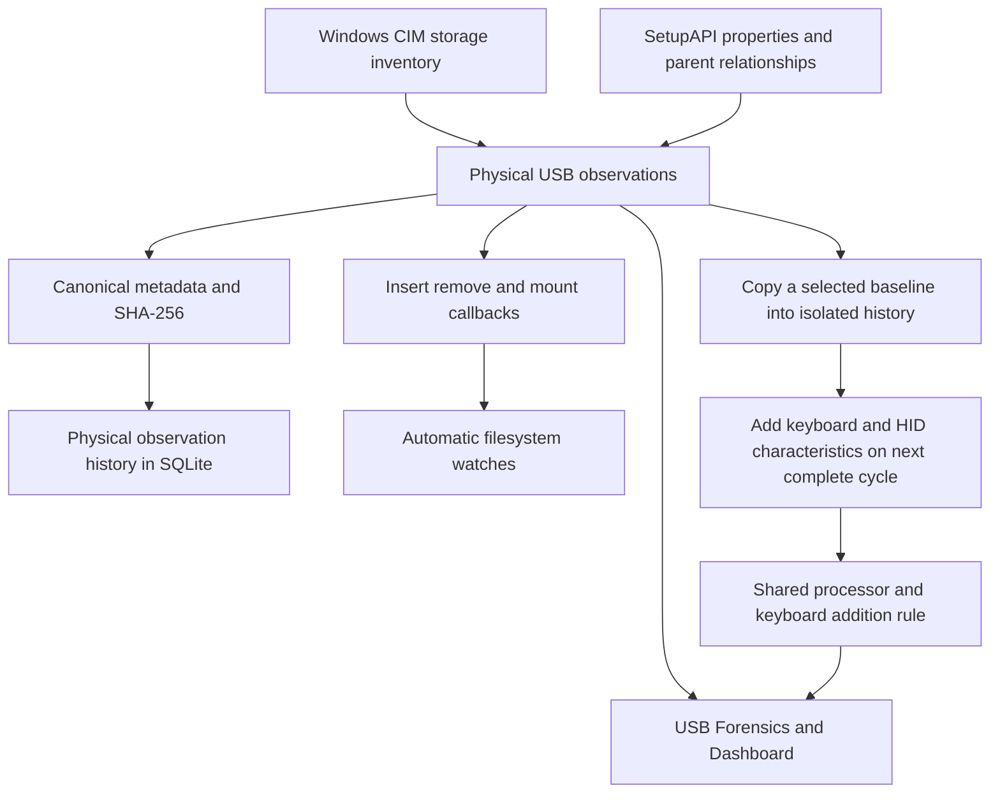

# USB Forensics and BadUSB Detection

ExfilTrace discovers connected Windows USB devices, inspects their Plug and Play functions, records connection activity, and compares deterministic metadata fingerprints over time. Storage mounts feed the file monitor automatically. The BadUSB demonstration adds a keyboard function to a copied observation of a selected real storage device, then passes it through the same fingerprint and comparison pipeline. It does not modify hardware or establish a confirmed physical BadUSB verdict.

## Implementation and responsibilities

| Source | Responsibility |
|---|---|
| [windows.py](../backend/app/usb/windows.py) | PowerShell/CIM storage discovery, inventory checks and inspection caching |
| [setupapi.py](../backend/app/usb/setupapi.py) | Read-only native Windows device enumeration and property collection |
| [inspection.py](../backend/app/usb/inspection.py) | Physical-device grouping, function classification, canonical metadata and SHA-256 |
| [monitor.py](../backend/app/usb/monitor.py) | Polling, connection/mount differences, failure handling and simulation serialization |
| [history.py](../backend/app/usb/history.py) | SQLite observations and fingerprint history |
| [processing.py](../backend/app/usb/processing.py) | Shared observation processor and unexpected-keyboard rule |
| [simulation.py](../backend/app/usb/simulation.py) | Selected-device overlay and isolated in-memory history |
| [service.py](../backend/app/service.py) | Connection events and automatic removable-volume watches |
| [USBForensics.jsx](../src/pages/USBForensics.jsx) | Device selection, inspection details, history and findings |
| [UsbSimulationControl.jsx](../src/components/UsbSimulationControl.jsx) | Header dropdown, eligibility explanations and clear/reset |



## Storage discovery and mounted drives

The Windows backend queries `Win32_DiskDrive` and selects USB storage disks by interface type or USBSTOR instance path. It traverses disk-to-partition and partition-to-logical-drive associations with `Get-CimAssociatedInstance`, using the provider's actual CIM objects rather than constructing escaped association paths manually.

Each discovered logical drive contributes a mount root, volume label, filesystem and size when available. A disk with multiple mounted partitions contributes multiple roots. An unmounted storage disk remains connected with an empty `mounts` list. No logic assumes a particular drive letter or a label such as `LARP`.

The default poll interval is three seconds. After a successful snapshot, `UsbMonitor` compares device identities and mount lists with its previous state:

- A new identity triggers an `INSERTED` event and adds watches for all mounted roots.
- A missing identity in a complete snapshot triggers `REMOVED` and drops its unused watches.
- A changed mount list triggers `MOUNT_CHANGED`, removes old roots and adds new ones.
- Devices present during the first successful poll are marked `preexisting`. Their recorded time is when monitoring discovered them, not their physical insertion time.

Watch ownership is retained when an unresolved storage identity later resolves into a physical USB root that still owns the same volume. This prevents the old identity's removal callback from undoing the new device's watch.

## Native interface inspection

The native collector calls `SetupDiGetClassDevsW` with present-device and all-class flags, then enumerates devnodes with `SetupDiEnumDeviceInfo`. It reads properties through `CM_Get_DevNode_PropertyW` and obtains parent relationships through `CM_Get_Parent` and `CM_Get_Device_IDW`.

Collected values include instance ID, parent ID, container ID, Windows PnP class, hardware IDs, compatible IDs, manufacturer, friendly name or description, and device capabilities. Optional properties that Windows does not provide remain unavailable. Enumeration is considered successfully finished only when Windows returns `ERROR_NO_MORE_ITEMS`; another termination is a failure.

The interface list represents Windows devnodes and functions. It can include the physical root, composite MI children and HID collection nodes. It is not a raw USB descriptor interface count. Windows PnP class names such as `Keyboard` and `HIDClass` are not USB descriptor class codes.

Function classification identifies storage, HID, keyboard, mouse, camera, imaging, audio, Bluetooth, network-interface and printer classes where recognizable. The `USB\COMPOSITE` compatible ID identifies a composite root. Collecting a network-interface class here does not inspect its network traffic.

## Grouping interfaces into physical devices

Physical roots are non-MI `USB\VID_xxxx&PID_xxxx` devnodes. The grouping algorithm follows parent ancestry and attaches USB, USBSTOR, HID and SCSI descendants to their nearest physical USB root. A separately rooted downstream USB device remains separate even if connected through another device.

Bluetooth peers behind a USB radio and software-enumerated descendants are excluded from that radio's interface fingerprint. Their presence is not a new physical function of the radio.

VID/PID, similar arrival times and serial similarity never merge devices. Container IDs are displayed as evidence but do not independently merge roots: Windows can assign a shared sentinel container to unrelated internal devices. If storage ancestry cannot be resolved, a separate partial fallback retains its mounted roots without inventing a serial or fingerprint.

## Device identity and serial numbers

Physical identity is the uppercase Windows root instance ID. Persisted observation identities also include the observation source, keeping Windows and other backends separate. A device without a bus-provided serial can receive a different instance identity when moved between ports. Identical products may share VID/PID and even metadata fingerprints while retaining separate observation records.

The `CM_DEVCAP_UNIQUEID` capability permits reporting the USB root's unique instance suffix as its bus-provided serial, with `serialSource` stating that origin. Otherwise the serial is null. A generated location suffix is not treated as a genuine serial. Manufacturer and product strings may be generic driver-provided descriptions rather than independently verified manufacturer claims.

Neither identifiers nor metadata hashes authenticate hardware. A device can impersonate identifiers, and legitimate driver changes can alter metadata.

## Deterministic metadata fingerprint

The version is `windows-pnp-metadata-v1`. The canonical object includes:

1. Fingerprint version, VID and PID.
2. Root manufacturer and product/friendly name.
3. Each interface's PnP class, hardware IDs, compatible IDs and function list.

ID and function arrays are deduplicated and sorted; collected hardware/compatible IDs are normalized to uppercase. Interface objects are consistently ordered by their sorted-key JSON representation. Duplicate interface objects remain so multiplicity is preserved. The final JSON uses sorted object keys, compact separators, explicit nulls and UTF-8 encoding with `ensure_ascii=False`. SHA-256 of those bytes becomes the fingerprint.

Excluded values include serial, instance/parent/container identifiers, interface friendly names, timestamps, drive letters, connection state, polling order and database IDs. Moving from `D:\` to `E:\` or receiving the interfaces in a different order therefore does not change the hash.

This is a **metadata fingerprint**, not a descriptor hash. Raw descriptors, USB version, descriptor class codes, power consumption and firmware revision are unavailable. Hardware IDs containing revision strings are retained as Windows metadata without being promoted to verified firmware values.

## Caching and incomplete collection

Storage associations refresh every poll. Detailed native properties are cached until the PnP inventory changes or sixty seconds elapse. `inspection.collectedAt` records the last detailed collection; `observation.lastSeen` records presence processing. A property-only change can take a minute plus a poll to appear.

Inventory changes between the CIM and native queries invalidate the cycle and cause a retry. Failed enumeration retains the previous state and exposes `usb_monitor.last_error`. Partial cycles conservatively defer removals and fingerprint comparisons, so failure is not interpreted as disconnection or malicious change.

Fingerprint comparison is also deferred when previously available root metadata or interface ID arrays become unavailable. The UI can show the retained reliable hash with `fingerprintRetained`. A complete query can still contain null optional properties; completeness refers to collection success, not universal property availability.

## SQLite history and API

| Table | Stored evidence |
|---|---|
| `usb_events` | Insertion, removal and mount changes, including startup context |
| `usb_observations` | Source-scoped physical identity, first/last seen and last reliable characteristics/hash |
| `usb_fingerprint_history` | Initial hash and subsequent changes, previous hash, version and before/after differences |

One observation row is updated per identity. Polling does not create duplicate fingerprint-history rows. `newlyObserved` means first recorded in this database during the current monitoring run; it stays true for that run and becomes false after restart. New observation/event timestamps use UTC ISO 8601 ending in `Z`.

| Endpoint | Purpose |
|---|---|
| `GET /api/usb/devices` | Connected devices, inspection, fingerprint and observation history |
| `GET /api/usb/observations` | Persisted evidence, including disconnected devices |
| `GET /api/usb/events` | Connection/mount history with filters and pagination |
| `GET /api/status` | Monitor state, query errors, connected devices and watches |
| `GET /api/usb/simulation` | Overlay state, eligible physical choices and isolated finding |
| `POST /api/usb/simulation` | Activate an overlay using `{ "deviceId": "<instance ID>" }` |
| `DELETE /api/usb/simulation` | Clear the overlay and isolated history |

The integrated API retains `{data, source: "live"}` wrappers and legacy device fields. Frontend normalization converts snake_case keys to camelCase without inventing unsupported properties.

## Keyboard addition rule and BadUSB demonstration

`USB_UNEXPECTED_KEYBOARD_ADDITION_V1` compares version-compatible canonical metadata. It returns a finding when the previous functions include storage, do not include keyboard, and the current functions newly include keyboard. A legitimate composite device already exposing a keyboard does not satisfy that addition rule.

The demonstration requires a connected physical Windows device with complete, suitable storage-only metadata and a reliable hash. Existing keyboard functions, other non-storage functions, unresolved ancestry and partial queries make selection unavailable with an explanation.

Activation performs an unmodified presence/processing cycle first and seeds an isolated in-memory SQLite history from a deep copy of the actual baseline. It does not construct an alert. On the next complete cycle, another copy gains a marked keyboard/HID interface. That interface's class, IDs and functions participate in canonical hashing; provenance flags do not.

The shared processor recalculates the hash, records the isolated comparison, and invokes the rule. The finding includes the physical reference, previous/current functions and hashes, timestamp, rule, changed characteristics and explanation. API provenance explicitly labels it simulated and uses the title `SIMULATED — possible USB impersonation`.

The overlay persists across polls without duplicate findings. Partial queries pause it. Clear/reset destroys the overlay and isolated history without producing a reverse hardware-change alert. Confirmed disconnect, a genuine baseline change or monitoring stop cancels it; reconnect does not automatically reactivate it. Polling and mutations share a lock, and simulation failures do not stop actual monitoring.

The real cached device, physical SQLite history, real alerts, trust state and filesystem watches are not overwritten by synthetic evidence. No driver, device record, firmware or keystroke is modified or executed.

## Website behavior and verification

Simulation disclosure and reset controls appear in the top-right dropdown, immediately left of the clock. USB Forensics and Dashboard use neutral interface-finding wording. The affected device is highlighted in amber with a Possible impersonation badge; real security totals do not include the isolated finding.

On USB Forensics, select the affected device under Connected physical USB devices. The table below its manufacturer/product/function details shows **Keyboard / HID interface**, functions **hid, keyboard**, and PnP class **Keyboard**. Synthetic Windows IDs display as unavailable, not as fabricated real identifiers. The frontend presentation projection does not change the backend provenance or hash input.

Enable the optional demonstration in PowerShell:

```powershell
Set-Location 'C:\Users\leoan\projects\exfiltrace-security-monitor'
$env:EXFILTRACE_USB_SIMULATION = '1'
& .\backend\.venv\Scripts\python.exe .\backend\run.py --host 127.0.0.1 --port 5000
```

The default is disabled; `usb.simulation_enabled: true` is the alternative JSON setting. Mutation endpoints additionally require a loopback client/host, local browser origin when provided, and `X-ExfilTrace-Simulation: 1`. Starting requires JSON and a running monitor.

In a second terminal, run `npm.cmd run dev` with `VITE_API_URL` pointing to the backend's `/api` base. Attach an eligible USB, select it in the dropdown, wait for the next successful poll, inspect the highlighted device and keyboard row, then clear it. Device Manager's Details tab can independently verify the actual instance/parent/class IDs; the overlay keyboard will not appear there because no hardware function was changed.

Tests in [test_usb.py](../backend/tests/test_usb.py), [test_usb_inspection.py](../backend/tests/test_usb_inspection.py) and [test_usb_simulation.py](../backend/tests/test_usb_simulation.py) cover grouping, duplicate VID/PID, stable hashing, partial failures, persistence, isolation and lifecycle. Run `& .\backend\.venv\Scripts\python.exe -m pytest backend/tests -q` and `npm.cmd test` from the repository root. Physical BadUSB verdicts and software write protection remain unimplemented.
